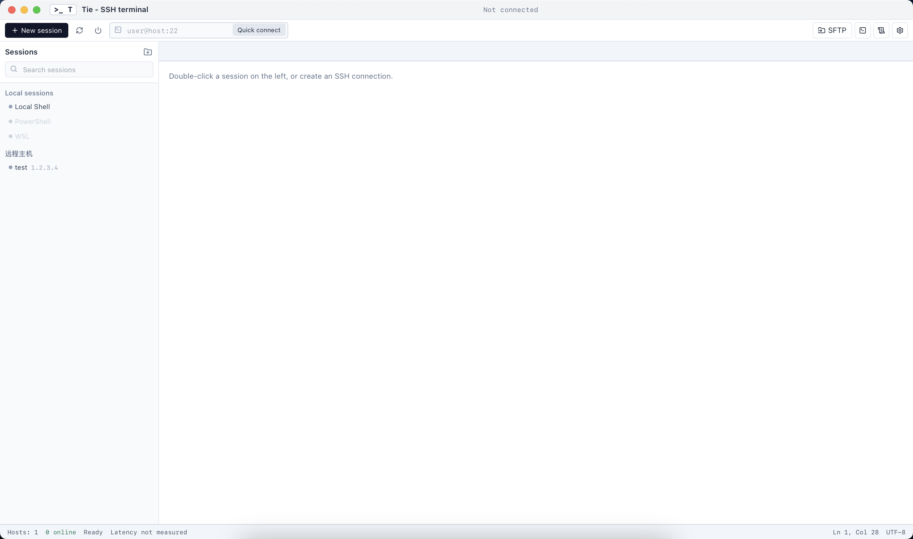
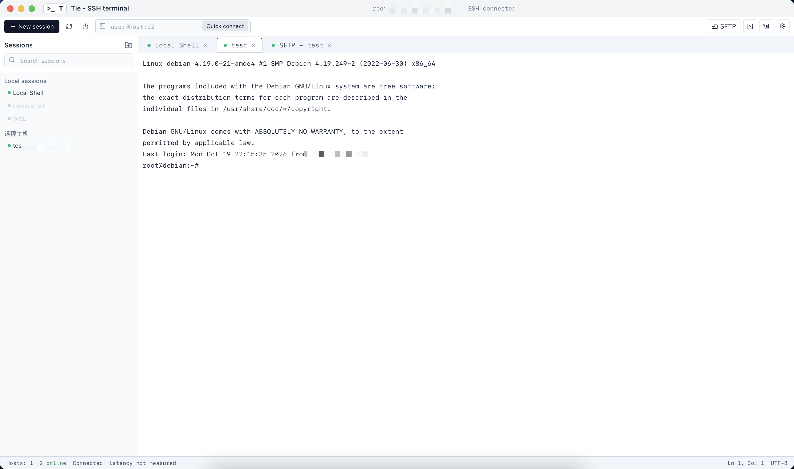
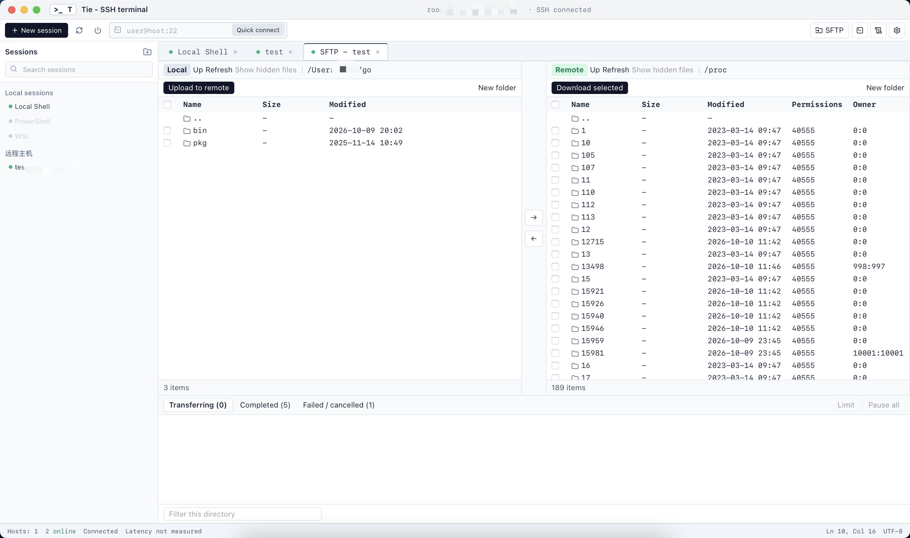
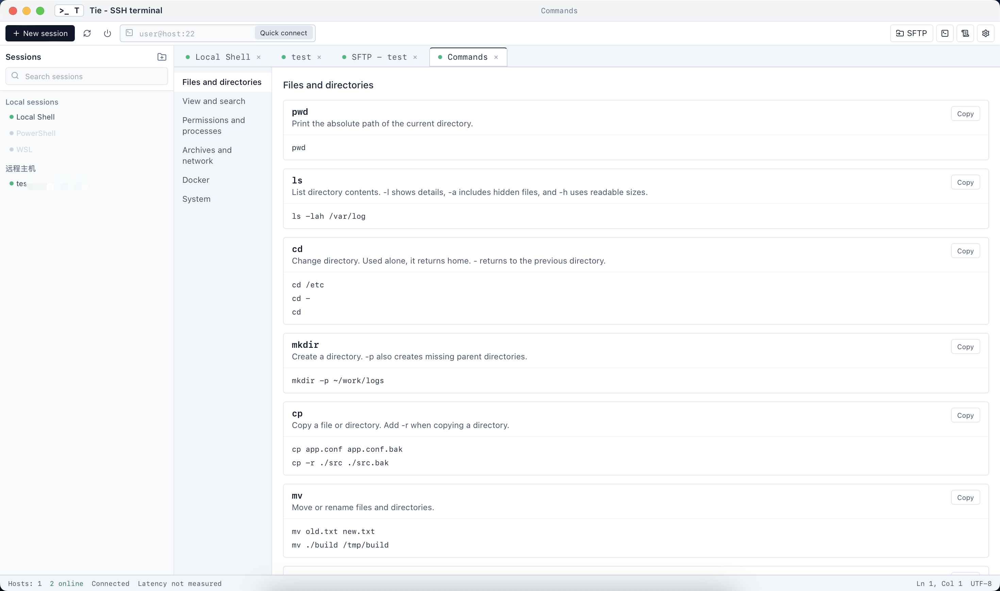

# Tie

[English](../README.md)

跨平台 SSH / SFTP 桌面客户端。界面是 Tauri 2 + React，协议栈使用 `russh` + `russh-sftp`，终端由 xterm.js 渲染。

## 界面

会话列表与快速连接：



SSH 终端：



SFTP 双栏传输：



常用命令：



## 范围

- SSH 交互终端（密码 / 私钥、应用目录中的 `known_hosts`、主机密钥确认）
- SFTP 双栏浏览与单文件上传下载（可取消，完成后写入 SQLite）
- 会话与分组（SQLite + 系统钥匙串）
- 本地 Shell 仍由 `tie-pty` 保留，尚未接到桌面界面

## 要求

- Rust stable
- Node.js 22+

## 开发

```bash
cd apps/desktop
npm install
npm run tauri dev
```

检查：

```bash
cargo test -p tie-store -p tie-ssh -p tie-desktop
cd apps/desktop && npm run check && npm run build
```

## 打包

在对应系统上执行。产物是可双击启动的图形程序，不要用终端去运行里面的可执行文件。

```bash
cd apps/desktop
npm install
npm run tauri build
```

Windows 正式版使用 GUI 子系统，双击不会弹出黑色控制台。`npm run tauri dev` 仍会附带终端，那只用于开发。

### macOS

需要已安装 Xcode 命令行工具。

产物：

- `src-tauri/target/release/bundle/dmg/Tie_0.1.0_<arch>.dmg`
- `src-tauri/target/release/bundle/macos/Tie.app`

打开 dmg，把 `Tie.app` 拖进「应用程序」，再从启动台或应用程序文件夹打开。

### Windows

需要 Visual Studio 的「使用 C++ 的桌面开发」工作负载，以及 WebView2 运行库（Windows 11 通常已自带）。

产物：

- `src-tauri/target/release/bundle/nsis/Tie_0.1.0_x64-setup.exe`
- `src-tauri/target/release/bundle/msi/` 下的 `.msi` 安装包

运行安装包完成安装，然后从开始菜单打开 Tie。

### Linux

Debian / Ubuntu 先安装界面依赖：

```bash
sudo apt update
sudo apt install libwebkit2gtk-4.1-dev build-essential curl wget file \
  libxdo-dev libssl-dev libayatana-appindicator3-dev librsvg2-dev patchelf
```

产物位于 `src-tauri/target/release/bundle/`：

- `deb/tie_0.1.0_<arch>.deb`：`sudo apt install ./tie_0.1.0_<arch>.deb`，然后从应用菜单打开 Tie
- `rpm/`：用系统的 rpm 安装器安装后，从应用菜单打开
- `appimage/tie_0.1.0_<arch>.AppImage`：加上执行权限后双击，或在文件管理器中打开

安装包注册的是图形桌面项，不会打开终端窗口。

## 数据位置

- macOS: `~/Library/Application Support/Tie/sessions.db`
- 主机密钥: 同目录 `known_hosts`，不会改写 `~/.ssh/known_hosts`
- Windows: `%APPDATA%\Tie\`

密码和私钥口令只进操作系统凭据存储。
